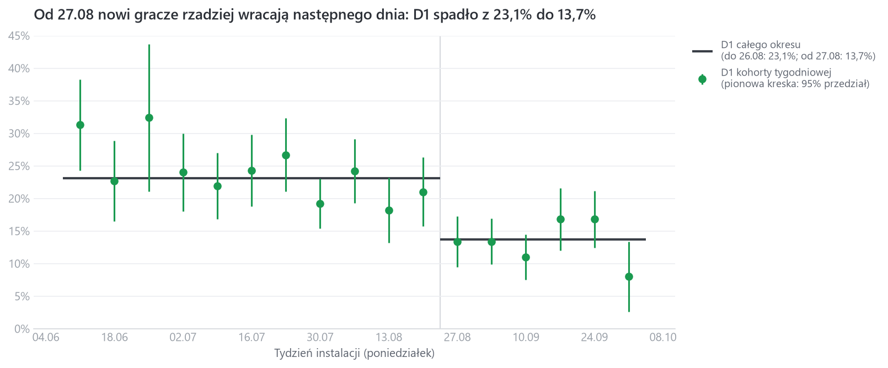
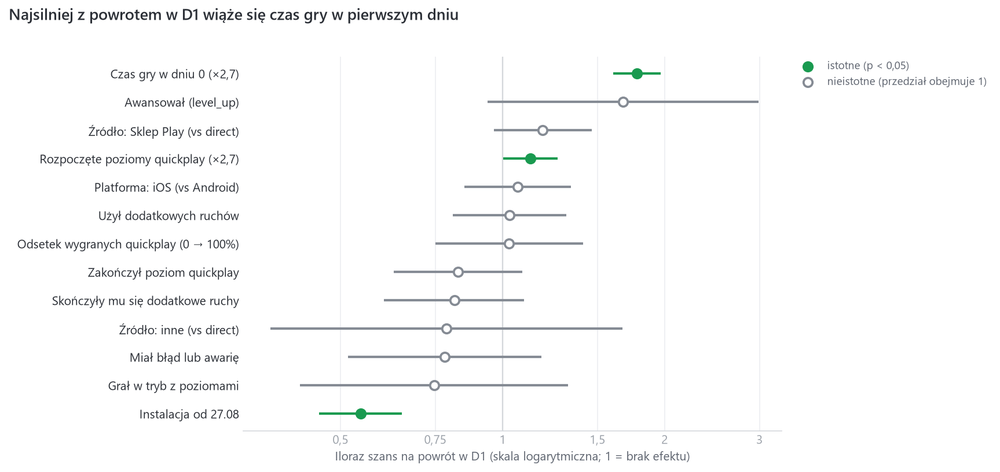

# Flood-It!: retencja i churn nowych graczy

Analiza retencji graczy mobilnej gry logicznej Flood-It! (Android i iOS) na publicznych danych eventowych Firebase/GA4
w BigQuery (`firebase-public-project.analytics_153293282`, 114 dni, 12.06–03.10.2018).

**Pytanie biznesowe:** ilu nowych graczy wraca do gry, kiedy i dlaczego odchodzą, oraz co zespół gry może z tym zrobić?

## W skrócie

- **Od 27.08.2018 retencja nowych graczy spadła o ok. 40%.** D1 (powrót następnego dnia): 23,1% → 13,7%.
- **Przyczyny nie widać w danych.** Spadek nie wynika z nowej wersji gry, kampanii reklamowej, zmiany struktury graczy
  ani z ich zachowania w pierwszym dniu. Gracze po 27.08 zaczynali tak samo, ale rzadziej wracali.
- **O powrocie decyduje głównie pierwsza sesja.** Czas gry w dniu instalacji to najsilniejszy sygnał, że gracz wróci.
- **Rekomendacja nr 1:** sprawdzić, co zmieniło się ok. 27.08 poza aplikacją (powiadomienia, konfiguracja serwerowa,
  pozycja w Google Play).



## Najważniejsze wnioski

1. **Retencja nowych graczy spadła skokowo od 27.08.2018.** D1 spadło z 23,1% do 13,7% (−9,4 pp, −41% względnie),
   D7 z 6,3% do 3,4%. Spadek jest istotny statystycznie (margines błędu ±1,7 pp) i utrzymuje się we wszystkich
   kolejnych tygodniach.
2. **Spadku nie wyjaśnia nic, co da się sprawdzić w danych.** Sprawdziłem i wykluczyłem po kolei:
   - **nową wersję gry:** ta sama wersja traci graczy na obu platformach (Android 2.62: −9,9 pp, iOS 2.6.31: −5,7 pp),
   - **kampanię płatną:** w całym okresie z płatnej reklamy przyszedł jeden gracz,
   - **zmianę struktury graczy:** D1 spadło w każdym segmencie platforma × źródło, nie tylko w średniej,
   - **inne zachowanie na starcie:** w dniu instalacji gracze po 27.08 grali tak samo albo więcej (mediana czasu gry
     2,7 → 2,5 min, rozpoczętych poziomów 1 → 2), a w modelu efekt okresu nie zmienia się po uwzględnieniu
     zachowania (iloraz szans 0,54),
   - **artefakt danych:** zmiana próbkowania eventów jest za mała, żeby wyjaśnić spadek.

   Przyczyna działa więc **między pierwszą a drugą sesją** (np. powiadomienia, przypomnienia, sezonowość), a tego
   dane nie obejmują.
3. **Najwięcej graczy gra traci od razu.** Ok. 80% nowych graczy nie wraca następnego dnia; w dniu 30 zostaje ok. 2%.
4. **Pierwsza sesja jest najsilniejszym sygnałem powrotu.** Gracz, który w dniu instalacji grał ok. 2,7 razy dłużej,
   ma o 78% większe szanse na powrót w D1. Różnice między platformami i źródłami pozyskania (np. wyższe D1 graczy
   ze Sklepu Play) znikają po uwzględnieniu czasu gry: „lepsze” segmenty to te, które więcej grają na starcie.
5. **Brak dodatkowych ruchów nie wypycha graczy.** W surowych danych gracze, którym skończyły się ruchy, wracali nawet
   częściej (24,5% wobec 18,9%), ale to efekt zaangażowania (żeby skończyły się ruchy, trzeba dużo grać).
   Po jego uwzględnieniu efekt jest nieistotny.



Jak czytać wykres: punkt na prawo od 1 to cecha zwiększająca szansę na powrót, na lewo zmniejszająca.
Pozioma kreska to 95% przedział ufności; jeśli przecina 1 (szare punkty), nie wiadomo, czy efekt istnieje.

## Rekomendacje

| # | Rekomendacja | Dlaczego |
|---|---|---|
| 1 | **Sprawdzić, co zmieniło się ok. 27.08 poza aplikacją:** powiadomienia push i przypomnienia, konfigurację serwerową (Remote Config), pozycję lub wyróżnienie w Google Play | Przyczyna leży poza danymi; najmocniej spadł segment ze Sklepu Play (D1 29,8% → 14,8%) |
| 2 | **Wydłużyć pierwszą sesję**, np. tutorialem prowadzącym do kilku ukończonych poziomów albo nagrodą za pierwsze minuty gry | Czas gry w dniu 0 to najsilniejszy predyktor powrotu |
| 3 | **Wczesne ostrzeganie w dniu 0:** do graczy z bardzo krótką pierwszą sesją kierować zachętę do powrotu (przypomnienie, nagroda za dzień 1); skuteczność potwierdzić testem A/B | Model odróżnia wracających od niewracających na poziomie akceptowalnym (AUC 0,71) |
| 4 | **Nie zmieniać ekonomii dodatkowych ruchów** na podstawie hipotezy frustracji | Dane jej nie potwierdzają |
| 5 | **Usprawnić telemetrię:** mniejsze próbkowanie eventów, eventy powiadomień, wersja konfiguracji serwera w eventach | Ograniczenia danych uniemożliwiły znalezienie przyczyny spadku |

## Dalsze kroki

- Cechy demograficzne (kraj, język) i dzień tygodnia instalacji w modelu.
- Retencja D7 w modelu (na razie za mało powrotów: ok. 210).
- Dashboard / hostowane demo z wykresami retencji.

---

## Jak to działa

```
BigQuery (events_*)  ──►  sql/stepN_*.sql  ──►  run_sql.py  ──►  data/stepN_*.csv  ──►  notatniki (model, wykresy)
```

1. Każde zapytanie to osobny plik w `sql/` z nagłówkiem: cel, wynik, decyzja.
2. `run_sql.py` robi darmowy dry run (szacunek kosztu), wykonuje zapytanie z limitem 2 GB i zapisuje wynik
   do `data/` pod tą samą nazwą. Błędy BigQuery pokazuje jedną czytelną linijką.
3. `step5b_model_d1.ipynb`: przygotowanie danych i regresja logistyczna (`statsmodels`) + ocena trafności
   (scikit-learn, walidacja krzyżowa).
4. `step6_readme_charts.ipynb`: wykresy do README, liczone wyłącznie z plików w `data/`.

Każda liczba w tym README pochodzi z zapytania w `sql/` albo z notatnika.

## Przebieg analizy

| Krok | Pliki | Co sprawdzałem | Najważniejszy wynik |
|---|---|---|---|
| 1 | `step1_overview`, `step1b_events_per_day` | Rozmiar i okres danych | 5,7 mln eventów, 15 175 graczy, 114 dni; **każdy dzień to dokładnie 50 000 eventów** (losowa próbka) |
| 2 | `step2_event_names` | Jakie eventy rejestruje gra | 37 eventów; dwa tryby gry (quickplay i poziomy) |
| 2b–2d | `step2b_first_open_check`, `step2c_first_open_gap`, `step2d_day_time_span` | Czy `first_open` to wiarygodny dzień 0; jak próbkowano eventy | 71% graczy nie ma `first_open` (weterani sprzed 12.06); próbka losowa z całego dnia |
| 3 | `step3_app_remove_by_platform`, `step3b_return_gaps`, `step3c_churn_validation` | Definicja churnu | Churn = 14 dni bez aktywności (91,8% powrotów mieści się w 14 dniach); walidacja: churned odinstalowują grę 2× częściej |
| 4 | `step4_retention_by_platform` … `step4d_sampling_check_by_month` | Retencja kohort | D1 19,5%, D7 5,3%, D30 1,9%; spadek od 27.08 |
| 4e–4h | `step4e_retention_by_app_version` … `step4h_retention_source_platform` | Przyczyny spadku | Ta sama wersja, obie platformy, brak kampanii, spadek w każdym segmencie |
| 5 | `step5a_player_features_d0`, `step5b_model_d1.ipynb` | Co odróżnia wracających | Czas gry w dniu 0; efekt okresu niezależny od zachowania na starcie |

## Definicje

- **Kohorta:** gracze z eventem `first_open` w dniu pierwszego pojawienia się w danych (4 307 graczy).
  **Dzień 0** = data `first_open`.
- **Aktywny dzień:** dzień z jakimkolwiek eventem oprócz `app_remove` i `app_clear_data` (odinstalowanie
  i czyszczenie danych nie oznaczają gry).
- **D1 / D7 / D30 (wersja klasyczna):** odsetek graczy aktywnych **dokładnie** w dniu 1 / 7 / 30. Mianownik to tylko
  kohorty, które miały co najmniej tyle dni danych.
- **Churn:** brak aktywności przez 14 dni od ostatniego aktywnego dnia. Powrót po dłuższej przerwie to reaktywacja.
- **Margines błędu:** 2·√(p(1−p)/n), czyli połowa 95% przedziału ufności (metoda Walda); dla różnicy dwóch
  odsetków 2·√(var₁ + var₂).
- **Iloraz szans (OR):** o ile cecha zmienia szansę na powrót przy pozostałych cechach stałych (1 = brak efektu).

## Porównanie z tutorialem Google

Google udostępnia na tych samych danych tutorial
[Churn prediction for game developers](https://github.com/GoogleCloudPlatform/vertex-ai-samples/blob/main/notebooks/official/workbench/gaming_churn_prediction/churn_prediction_for_game_developers.ipynb)
(BigQuery ML, XGBoost). Ma inny cel (technika budowy modelu predykcyjnego, bez wniosków), a moje podejście różni się
w dwóch decyzjach:

| | Tutorial Google | Ten projekt |
|---|---|---|
| Kto jest nowym graczem | każdy gracz z `user_engagement`; dzień 0 = pierwsze pojawienie się w danych | tylko gracze z `first_open`, bo 71% graczy w danych to weterani sprzed okresu obserwacji |
| Gracze z krótką pierwszą sesją | wykluczeni jako „bounced” (< 10 min, ok. 41% graczy) | zostają, bo właśnie tam gra traci najwięcej graczy (mediana czasu gry w dniu 0: 2,6 min) |
| Próbkowanie 50 000 eventów/dzień | nieomawiane | wykryte i uwzględnione w interpretacji |
| Cel modelu | predykcja (XGBoost) | wyjaśnienie (regresja logistyczna z przedziałami ufności) + ocena trafności (AUC) |

## Ograniczenia

- **Próbkowanie:** każdy dzień to losowa próbka dokładnie 50 000 eventów. Bezwzględne wartości retencji są przez to
  zaniżone (gracz może grać, ale nie mieć eventu w próbce), dlatego wnioski opieram na porównaniach między grupami.
  Efekt czasu gry i AUC mogą być lekko zawyżone (gracz z dużą liczbą eventów częściej trafia do próbki także w dniu 1).
- **Kohorty** obejmują tylko graczy z `first_open` (4 307 z 15 175), bo tylko dla nich znany jest dzień instalacji.
- **Brak danych** o powiadomieniach, konfiguracji serwerowej i pozycji gry w sklepach, czyli o najbardziej
  prawdopodobnych przyczynach spadku.
- **Model wyjaśnia niewielką część zmienności** (pseudo R² 0,10): powrót gracza zależy od wielu czynników spoza gry.
- **Odinstalowanie (`app_remove`)** jest rejestrowane tylko na Androidzie, więc służy wyłącznie do walidacji definicji
  churnu.

## Uruchomienie

Wymagania: Python 3, konto Google Cloud z dostępem do BigQuery (wystarczy darmowy sandbox), `gcloud` CLI.

```bash
python -m venv .venv
.venv\Scripts\activate                       # Windows; na macOS/Linux: source .venv/bin/activate
pip install -r requirements.txt
gcloud auth application-default login        # logowanie do BigQuery
copy .env.example .env                       # i wpisz w .env ID swojego projektu GCP
```

Zapytania (wyniki trafiają do `data/`, które jest już w repozytorium):

```bash
python run_sql.py step4c_retention_two_periods
python run_sql.py step4b_retention_by_week step4c_retention_two_periods     # kilka naraz
```

Model i wykresy: uruchom `step5b_model_d1.ipynb`, a potem `step6_readme_charts.ipynb`.

## Zawartość repozytorium

| Ścieżka | Co zawiera |
|---|---|
| `sql/` | Wszystkie zapytania BigQuery, każde z nagłówkiem: cel, wynik, decyzja |
| `data/` | Wyniki zapytań (CSV) pod tymi samymi nazwami co pliki SQL |
| `run_sql.py` | Uruchamianie zapytań z dry runem, limitem kosztu i zapisem do CSV |
| `step5b_model_d1.ipynb` | Przygotowanie danych, regresja logistyczna D1, AUC |
| `step6_readme_charts.ipynb` | Wykresy do README |
| `viz_style.py` | Wspólny styl wykresów |
| `docs/img/` | Wykresy użyte w README |
| `requirements.txt`, `.env.example` | Zależności i wzór konfiguracji |

## Technologie

BigQuery (SQL: CTE, funkcje okna, `UNNEST`, `STRUCT`), Python (pandas, statsmodels, scikit-learn, matplotlib),
Jupyter, Google Cloud SDK, Claude (Claude Code w VS Code).

## Praca z Claude

Podczas projektu korzystałem z Claude (Claude Code w VS Code) jako asystenta. Pomagał mi:

- przygotowywać i objaśniać zapytania SQL oraz kod w Pythonie (każdy element, np. funkcje okna, `UNNEST`,
  regresję logistyczną),
- wychwytywać błędy, np. liczenie odinstalowania jako aktywności gracza czy słowo zastrzeżone w nazwie CTE,
- pisać dokumentację: nagłówki zapytań, dziennik decyzji i to README. Do pisania dokumentacji Claude sprawdził się
  świetnie.

Pracowałem małymi krokami: każdą decyzję analityczną (definicję kohorty i churnu, próg 14 dni, dobór cech modelu,
interpretację wyników) omawiałem i zatwierdzałem sam, a każdy wynik sprawdzałem w danych przed przejściem dalej.
